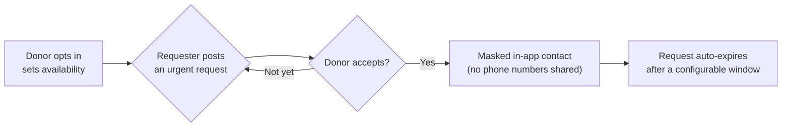

<!-- Logo placeholder — drop a logo at public/logo.png and reference it here -->
<h1 align="center">RaktSetu</h1>
<p align="center"><strong>Privacy-first blood donor &amp; recipient connect platform.</strong></p>
<p align="center">Blood should be easier to find than a working phone number. This is RaktSetu's shot at that.</p>

<p align="center">
  <a href="./LICENSE"></a>
  <a href="./CONTRIBUTING.md"></a>
  <a href="https://github.com/saisiddi/raktsetu/actions/workflows/ci.yml"></a>
  
</p>

<p align="center">
  
  
  
  
  
</p>

<p align="center">
  <!-- Update this once deployed: -->
  <a href="https://raktsetu.vercel.app"><strong>Live Demo</strong></a> ·
  <a href="#quick-start">Quick Start</a> ·
  <a href="./CONTRIBUTING.md">Contribute</a> ·
  <a href="./docs/ROADMAP.md">Roadmap</a> ·
  <a href="https://github.com/saisiddi/raktsetu/labels/good%20first%20issue">Good First Issues</a>
</p>

---

> [!IMPORTANT]
> RaktSetu is **privacy-first by design**: donor phone numbers are never shown publicly, nothing is scraped from WhatsApp or social media, and the platform never asks anyone for money. The app you're looking at right now is a **Phase 1 demo** — every form says so, and nothing you type is sent or stored anywhere yet.

## Table of contents

- [The problem](#the-problem)
- [The solution](#the-solution)
- [How it works](#how-it-works)
- [Features](#features)
- [Privacy principles](#privacy-principles)
- [Screenshots](#screenshots)
- [Tech stack](#tech-stack)
- [Quick start](#quick-start)
- [Project structure](#project-structure)
- [How to contribute](#how-to-contribute)
- [Roadmap](#roadmap)
- [FAQ](#faq)
- [Maintainer](#maintainer)
- [License](#license)

## The problem

Blood availability information in India is scattered across government portals, hospital lists, and WhatsApp forwards. In an emergency:

- Families **waste precious time** hunting through outdated group chats.
- Donor **phone numbers end up public**, forwarded past anyone who ever consented to it.
- Fake **"urgent blood" money scams** prey on exactly the people who can least afford to stop and verify.

## The solution

One clean platform that does three things well:

| &nbsp; | What                                           | How                                                                                                                         |
| ------ | ---------------------------------------------- | --------------------------------------------------------------------------------------------------------------------------- |
| **1**  | **Find** nearby blood banks and donation camps | Searchable directory, with a direct link to the official [e-RaktKosh](https://www.eraktkosh.in/) portal for real-time stock |
| **2**  | **Post** verified urgent blood requests        | Hospital name + city required, auto-expires, never asks for money                                                           |
| **3**  | **Connect** with opt-in donors                 | Masked, in-app contact only — never a public phone number                                                                   |

## How it works



No step in this flow ever puts a donor's phone number where a stranger can see it.

## Features

<table>
<tr><td width="50%" valign="top">

### Shipped — Phase 1

- Landing page, with the pitch, the privacy promise, and the anti-scam notice up front
- Blood bank search/filter over demo data, plus a direct link to e-RaktKosh
- Urgent request form (demo mode) with auto-expiry and anti-scam messaging
- Donor sign-up form (demo mode) with an availability toggle
- Donor listing — first name, blood group, city, availability only, **no phone numbers, ever**
- Site-wide "Demo" banner so nobody mistakes this for a live service yet
- i18n-ready UI strings (`/locales/en.json`), translators just add a new `.json` file

</td><td width="50%" valign="top">

### Coming — Phase 2 & 3

- Supabase auth and real donor registration
- Masked, realtime in-app chat (donor and requester never trade numbers)
- Server-enforced request expiry
- Leaflet + OpenStreetMap for blood bank locations
- Additional language translations (Hindi, Kannada, ...)
- Full accessibility audit + automated testing
- Anti-scam reporting flow

See the full breakdown in [docs/ROADMAP.md](./docs/ROADMAP.md).

</td></tr>
</table>

## Privacy principles

RaktSetu is built around six rules that are **not up for debate**. The full detail — including the Phase 2 data-handling plan — lives in [docs/PRIVACY.md](./docs/PRIVACY.md).

<details>
<summary><strong>Show all six principles</strong></summary>

<br>

1. **Opt-in donors only** — never scraped or imported from social media, WhatsApp, or third-party lists.
2. **No public phone numbers** — contact only via in-app chat / masked contact, after the donor accepts.
3. **Verified, auto-expiring requests** — hospital name + city required, requests expire automatically, never ask for money.
4. **Official stock data, not scraping** — we link to [e-RaktKosh](https://www.eraktkosh.in/) instead of scraping it.
5. **Obviously fake demo data** — every sample in this repo is clearly labelled "Demo" (e.g. `Demo Donor 1`, phone `XXXXXXXXXX`).
6. **Configurable donation gaps** — donors auto-pause after donating until a configurable minimum gap has passed; that number lives in `lib/config.js`, never hardcoded into UI copy.

</details>

## Screenshots

<!-- Add screenshots here once the UI is deployed, e.g.: -->
<!--  -->

_Screenshots coming soon — the [live demo](https://raktsetu.vercel.app) is the best preview for now._

## Tech stack

<p>
  
  
  
  
  
  
  
</p>

- **[Next.js](https://nextjs.org)** (App Router), plain **JavaScript** (no TypeScript, by design — this is a beginner-friendly project)
- **[Tailwind CSS](https://tailwindcss.com)** for styling
- Static JSON data in `/data` for Phase 1 — no backend, no database yet
- ESLint + Prettier, GitHub Actions CI, deployed on **[Vercel](https://vercel.com)**
- Phase 2 (planned): **[Supabase](https://supabase.com)**, **[Leaflet](https://leafletjs.com)** + OpenStreetMap

## Quick start

```bash
git clone https://github.com/saisiddi/raktsetu.git
cd raktsetu
npm install
npm run dev
```

Open [http://localhost:3000](http://localhost:3000). The Node version is pinned in [.nvmrc](./.nvmrc).

```bash
npm run lint      # ESLint
npm run format    # Prettier
npm run build     # production build
```

### Enable Supabase auth

To integrate Supabase:

1. Create a free project at [supabase.com](https://supabase.com).
2. In the project dashboard's **Get Connected** section, click on **Framework**. In the pop-up that appears, keep the default selections and copy the `NEXT_PUBLIC_SUPABASE_URL` and `NEXT_PUBLIC_SUPABASE_PUBLISHABLE_KEY` values it shows into your .env.local file.

3. Alternatively, in the project dashboard, open **Project Settings → API Keys** and copy the project URL and the **publishable key** (`sb_publishable_...`). Older projects may call this the `anon` key; it goes in the same variable.

4. Copy the example env file and fill in the two values:

   ```bash
   cp .env.example .env.local
   ```

   ```
   NEXT_PUBLIC_SUPABASE_URL=https://<your-project>.supabase.co
   NEXT_PUBLIC_SUPABASE_PUBLISHABLE_KEY=sb_publishable_...
   ```

Notes:

- Only the publishable key belongs in the app. Secret keys (formerly `service_role`) bypass Row Level Security and must never go in a `NEXT_PUBLIC_` variable or client-side code.
- Supabase's built-in email sender is heavily rate-limited, so repeated test sign-ups can fail with `over_email_send_rate_limit` (HTTP 429). For local testing, turn off "Confirm email" for the Email provider in the project's Authentication settings, or configure custom SMTP.
- Use throwaway accounts when testing, not real personal data.

## Project structure

```
app/            Next.js App Router pages
components/     Reusable UI components
data/           Static demo JSON (Phase 1 "database")
lib/            Helpers: i18n.js, config.js
locales/        UI strings (en.json — add hi.json, kn.json, ... to translate)
public/         Static assets
docs/           Project docs (privacy, roadmap, architecture, starter issues)
.github/        Issue/PR templates, CI, labels
```

## How to contribute

RaktSetu is a **beginner-friendly** project built for Nexus Spring of Code, a 45-day student open-source program. It welcomes contributors from every domain — you don't need to be a Next.js expert to make a real contribution:

| Domain          | Example tasks                                            |
| --------------- | -------------------------------------------------------- |
| **Frontend**    | New pages, UI polish, responsive fixes, dark mode        |
| **Backend**     | Phase 2 API routes, Supabase integration                 |
| **UI/UX**       | Design review, accessibility audit, empty/loading states |
| **Docs**        | README improvements, FAQ, architecture notes             |
| **Translation** | Add `hi.json`, `kn.json`, ... to `/locales`              |
| **Testing**     | Unit tests, Lighthouse checks, manual QA                 |

**Getting started in three steps:**

1. Browse [docs/STARTER_ISSUES.md](./docs/STARTER_ISSUES.md) or any issue labelled [`good first issue`](https://github.com/saisiddi/raktsetu/labels/good%20first%20issue), and comment to get assigned.
2. Fork, branch (`feat/`, `fix/`, `docs/`), and build — `npm run lint` and `npm run build` must pass before you open a PR.
3. Open a **draft PR** early so maintainers can see your direction; fill in the [PR template](./.github/pull_request_template.md), then click **"Ready for review"** when it's done.

The full process — commit conventions, branch naming, what gets closed as spam — is in [CONTRIBUTING.md](./CONTRIBUTING.md).

## Roadmap

<details>
<summary><strong>Phase 1 — Static demo (done)</strong></summary>

<br>

Next.js + Tailwind scaffold, all core pages, demo-mode banners, i18n-ready strings, ESLint + Prettier, CI. No backend — nothing submitted through a form is persisted.

</details>

<details>
<summary><strong>Phase 2 — Real data and contact</strong></summary>

<br>

Supabase auth, real donor registration with server-enforced donation gaps, persisted urgent requests with server-side expiry, realtime masked chat, and a reporting/moderation flow.

</details>

<details>
<summary><strong>Phase 3 — Reach and polish</strong></summary>

<br>

Leaflet + OpenStreetMap, notifications for matching nearby donors, additional language translations with a language switcher, a full accessibility audit, and dedicated anti-scam reporting.

</details>

Full detail in [docs/ROADMAP.md](./docs/ROADMAP.md).

## FAQ

<details>
<summary>Is this live? Can I actually find a donor right now?</summary>
<br>
Not yet. Phase 1 is a UI demo — every form says "demo mode" and nothing is saved. Real donor data and contact arrive in Phase 2.
</details>

<details>
<summary>Will my phone number ever be shown publicly if I sign up as a donor?</summary>
<br>
No. That's principle #2 of <a href="./docs/PRIVACY.md">docs/PRIVACY.md</a> and it's non-negotiable. Contact always happens through in-app, masked channels, after you accept.
</details>

<details>
<summary>Does RaktSetu ever ask for money?</summary>
<br>
Never. If anyone claiming to be RaktSetu (or using it) asks you to pay for blood or for a donor's contact details, that's a scam — not us.
</details>

<details>
<summary>I'm new to open source. Can I really contribute?</summary>
<br>
Yes — that's the point. Start with <a href="./docs/STARTER_ISSUES.md">docs/STARTER_ISSUES.md</a>, pick a <code>good first issue</code>, and <a href="./CONTRIBUTING.md">CONTRIBUTING.md</a> walks through the rest.
</details>

## Maintainer

**Sai** — [github.com/saisiddi](https://github.com/saisiddi), Project Admin for Nexus Spring of Code.

## License

[MIT](./LICENSE)
