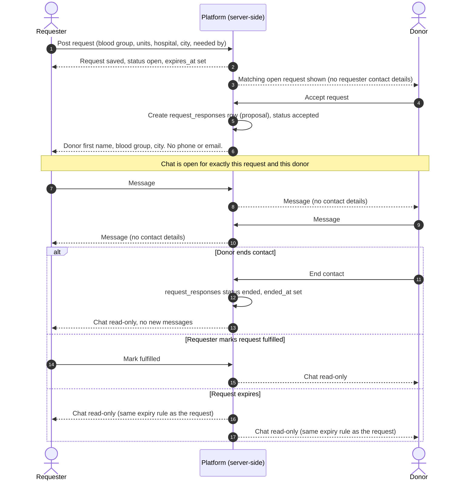
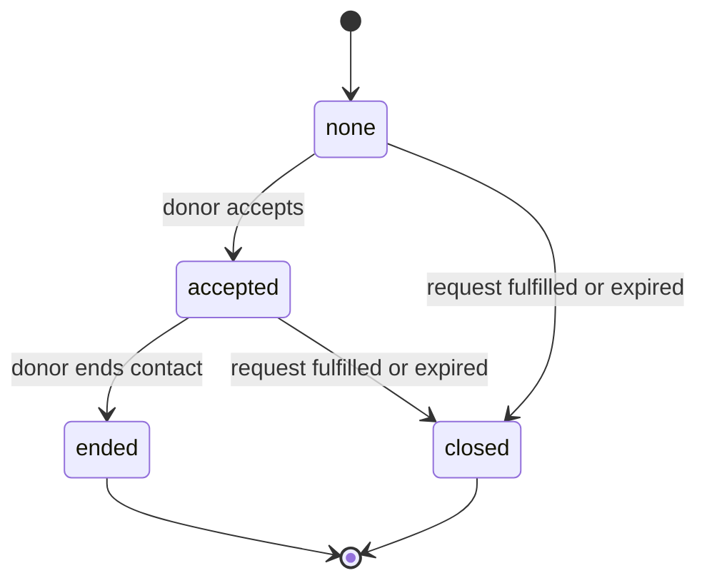

# Masked contact and in-app chat flow

Design for how a requester and a donor get in touch without either side ever seeing the other's phone number. It covers the request, accept, chat sequence, what each party can see at each step, how a donor ends contact, and how all of this stays consistent with [docs/PRIVACY.md](../PRIVACY.md) principle 2.

## Status of this document

Nothing described here is built. Phase 1 is a static app with no backend. What exists today and what is only proposed are kept apart on purpose:

| Label | Meaning |
| ----- | ------- |
| **Exists today** | Verifiable in the repo at the time of writing, with the file named. |
| **Documented plan** | Already written down in `docs/PRIVACY.md`, `docs/ARCHITECTURE.md` or `docs/ROADMAP.md`, but not implemented. |
| **Proposal** | New in this document. The Phase 2 schema is still being drafted by the maintainer, so every proposal here is a starting point for that discussion, not a decision. |

Proposals are marked **(Proposal)** in the text. Three areas are proposals in full: how contact is revealed and how it ends, message retention, and the `request_responses` table.

## What exists today

- The donors page renders `components/DonorCard.js`. Its "Request Contact" button only flips local React state and shows the demo-mode notice (`donors.demoModeNotice` in `locales/en.json`). It sends nothing.
- `data/donors.demo.json` has no phone field, as stated in PRIVACY.md principle 2.
- `app/request/page.js` validates client-side and shows a demo-mode message on submit. It shows the `request.fields.contactNote` text saying contact happens through masked, in-app contact. It does not collect or store a phone number.
- `components/ReportButton.js` offers the reasons `scam`, `spam` and `abuse` and, on submit, only shows a demo-mode notice. Nothing is persisted.
- `lib/config.js` has `REQUEST_EXPIRY_HOURS = 48` and `DONATION_GAP_DAYS = 90`. There is no message-retention constant.
- `lib/supabaseClient.js` creates a browser Supabase client only when the public env vars are set. `app/sign-up/page.js` asks for a name, email and password; it does not ask for a phone number.
- There are no SQL files, migrations, row-level security policies, server functions or realtime code in the repository.

## Documented plan (not implemented)

- `docs/ARCHITECTURE.md` plans the tables `users`, `donors`, `requests`, `messages` and `reports`, with exact column types left to a Phase 2 design issue. It says contact is "brokered through server-side logic" and that row-level security keeps `users.phone` unreadable by other users' clients.
- `docs/PRIVACY.md` principle 2: contact happens only through in-app chat or a masked-contact mechanism, and only after the donor has explicitly accepted. The Phase 2 plan adds that phone numbers are never returned to another user's client, and leaves data retention to "a Phase 2 design doc".
- `docs/ROADMAP.md` Phase 2: Supabase Realtime-backed chat between a requester and an accepting donor, and a moderation flow for reporting.
- Request expiry: PRIVACY.md principle 3 and the Phase 2 plan say expiry is enforced server-side so an expired request's details stop being servable. A separate design, issue #23 (PR #75, still open when this was written), proposes computing expiry on read from `created_at` and `REQUEST_EXPIRY_HOURS`. This document does not restate those rules; see [Expiry and retention](#expiry-and-retention).

## Goals and non-goals

Goals:

- A donor's phone number and email are never visible to a requester, and the requester's are never visible to the donor, at any step.
- A donor must explicitly accept before any message can be sent.
- A donor can end contact at any time, without giving a reason, and the requester cannot re-open it.
- Contact cannot outlive the request it belongs to.

Non-goals (open to the maintainer to change):

- Preventing people from moving the conversation off-platform. If someone types a number into a chat, the platform cannot fully stop that. See [Open questions](#open-questions).
- Group chat, attachments, voice or video.
- Notifications. These are Phase 3 in ROADMAP.md.

## Parties and roles

- **Requester**: the signed-in user who posted the request (`requests.requester_user_id`).
- **Donor**: a signed-in user with a `donors` row, who may respond to a request.
- **Platform**: server-side logic (for example Supabase Edge Functions or Postgres functions). It is the only component that may read `users.phone`. This is the documented plan; the specific technology is not decided.

## Sequence

This is the proposed happy path plus the ways it ends. `request_responses` is a proposal and is not in `docs/ARCHITECTURE.md` today.



Contact state for one donor and one request **(Proposal)**:



Messaging is allowed only in `accepted`. `ended` and `closed` are read-only. There is deliberately no transition from `ended` back to `accepted`, so a requester cannot pressure a donor into re-opening a conversation they ended. Whether `none` needs a stored row is an open question.

## What each party can see at each step

"Source" is the documented rule the row follows, or "proposal" where it is new.

| Step | Requester sees | Donor sees | Neither sees | Source |
| ---- | -------------- | ---------- | ------------ | ------ |
| Request posted | Own request in full | Blood group, units, hospital, city, needed by, time remaining | Requester phone or email | PRIVACY.md 2 and 3; requests table |
| Donor browses | Donor first name, blood group, city, availability (what the donors list shows today) | n/a | Donor phone or email | PRIVACY.md 2; `components/DonorCard.js` |
| Donor accepts | Donor first name, blood group, city, and that this donor accepted | That their acceptance went through | Phone, email, last name, `last_donated_on` | PRIVACY.md 2; donors table note "only first name is ever shown"; the response row is a proposal |
| Chat open | Message bodies and timestamps from the donor | Message bodies and timestamps from the requester | Phone, email, user ids of the other side | PRIVACY.md 2; proposal |
| Donor ends contact | That the chat is closed, and the existing messages read-only | The same, read-only | Phone, email | Proposal |
| Request fulfilled or expired | Read-only history until retention ends | Read-only history until retention ends | Phone, email | Proposal; expiry per [Expiry and retention](#expiry-and-retention) |

Before accepting, the donor sees the requester's hospital and city because PRIVACY.md principle 3 requires every request to carry them and a donor cannot meaningfully accept without them. The requester's phone number is not needed at any step of this flow, so the proposal is that the platform never sends it to the donor at all. It may still be stored for sign-in (`users.phone`).

## How contact is revealed (Proposal)

In this design contact is never "revealed" as a phone number. What the accept step unlocks is the ability to exchange messages inside the app. Two mechanisms would satisfy principle 2; the maintainer should pick one.

- **Option A, in-app chat only (suggested starting point).** Accepting opens a chat thread. The platform never releases a phone number. Simplest to reason about and needs no telephony vendor. Downside: someone in a hospital corridor may prefer a call.
- **Option B, masked calling or messaging relay.** The platform issues a temporary proxy number or relay address that forwards to the real one and is torn down when contact ends. Closer to what people expect in an emergency, but it needs a third-party provider, costs money, and moves phone numbers to that provider, which would have to be justified under principle 2. This document does not evaluate providers.

The rest of the document assumes Option A. Option B would reuse the same accept and end states; only the channel changes.

## How a donor ends or revokes contact (Proposal)

- A donor can end contact at any time from the chat. No reason is required.
- Ending sets the response status to `ended` and records `ended_at`. The chat becomes read-only for both sides. The server rejects new messages for that pair; hiding the input box in the UI is not enough.
- The requester cannot re-open it. The requester can still report the donor or the conversation (see [Abuse cases](#abuse-cases)).
- If a donor becomes unavailable or paused (`donors.available`, `paused_until`) while a chat is open, whether that should end the chat automatically is an open question.
- Account deletion by either side is not covered by ARCHITECTURE.md. Proposal: it ends all of that user's open responses, and message handling then follows the retention rule below.

## Privacy implications

A phone number tied to "this person gives blood" or "this family needs blood at this hospital" is health-adjacent. It makes donors targets for repeated calls, scams and harassment, and exposes patients' families. Consequences for the design:

- **Server-side only.** The documented plan is that `users.phone` is not readable by other users' clients and contact is brokered server-side. Every API response and realtime payload for the chat should be built from an explicit allow-list of fields (message body, timestamp, which side sent it), never by returning a whole `users` row. (Proposal)
- **Realtime is a leak path.** Supabase Realtime delivers row changes to subscribed clients subject to row-level security. A policy mistake on `messages` could deliver private messages to the wrong user. Whether the chat subscribes to the table or goes through a server relay is undecided; either way the policy needs testing with two unrelated users.
- **Identifiers.** `messages.sender_user_id` is a user id. If clients receive raw user ids they could be correlated elsewhere. Proposal: return only a "mine or theirs" flag to the client.
- **Message bodies can contain numbers.** ARCHITECTURE.md says bodies never contain either party's raw phone number "by design", but nothing in the repo enforces that. See [Open questions](#open-questions).
- **Logs.** PRIVACY.md says phone numbers must not appear in logs. Message bodies are free text that may include numbers, so proposal: message bodies are not logged either.
- **Demo data.** CONTRIBUTING.md and PRIVACY.md principle 5 apply to any future fixtures for this flow: obviously fake names and `XXXXXXXXXX` for phones.

## Abuse cases

Each is a risk the design has to answer. Mitigations are proposals unless a document is named.

| Abuse | Why it matters here | Proposed mitigation |
| ----- | ------------------- | ------------------- |
| Fake requests to harvest donors | A requester posts fake requests to get many donors chatting | Hospital and city are required (PRIVACY.md 3). Rate limit requests per user. Reports on requests (`target_type = request`). |
| "Pay for blood" scam | PRIVACY.md 3 says RaktSetu never asks for money | Show the anti-scam notice inside the chat as well. Report action on every message. |
| Pressure and repeated asks | A requester keeps messaging after the donor wants to stop | Donor can end contact and the requester cannot re-open it. Limit messages a requester can send before the donor first replies. |
| Sharing a phone number in chat | Defeats masking; the other side can then call or pass it on | Open question (see below). |
| Contacting many donors at once | One requester spams donors | Cap simultaneous open chats per request and per requester; numbers left to the maintainer. |
| Donor harassing a requester | Abuse in the other direction | Requester can report too. Proposal: a requester can also end the thread. |
| Reading someone else's chat | Guessing ids to read messages | Row-level security on `messages` and `request_responses` limited to the two parties. Non-guessable uuids are not a substitute for policies. |
| Abusing the report flow to silence a donor | Mass false reports | Reports are reviewed (`reports.status`); no automatic action on a single report. |
| Evidence disappears before review | Retention deletes a reported message | Hold messages referenced by an open report until it is reviewed (see retention). |

## Expiry and retention

### Expiry: aligned, not restated

Request expiry is defined by PRIVACY.md principle 3 and `REQUEST_EXPIRY_HOURS` in `lib/config.js` (currently 48), and by the expiry design in issue #23 (PR #75, `docs/design/request-expiry.md`, not merged when this was written). This document adds no expiry number and no second constant. The only rule it adds is a consequence:

- **(Proposal)** A chat is writable only while its response is `accepted`, its request is not fulfilled, and its request is not expired. "Not expired" must come from whatever rule the expiry design settles on, so the chat and the request can never disagree. If expiry is computed on read, as PR #75 recommends, the server-side message-send path must apply the same check, because sending a message is a write path of its own.

There is an unresolved mismatch outside this document's scope. `docs/ARCHITECTURE.md` has a stored `requests.status` value `expired` and an `expires_at` column; PRIVACY.md describes a scheduled job; PR #75 recommends no stored expired status. Which one wins decides how the chat learns that the request expired. It is listed in the open questions.

### Retention of messages (Proposal)

PRIVACY.md defers retention to a Phase 2 design doc, and there is no constant for it today. Proposal, for the maintainer to adjust:

- After a chat closes (ended, fulfilled or expired), keep it read-only for both sides for a short configurable period, then delete the message bodies.
- Put the period in `lib/config.js` as a named constant, for example `MESSAGE_RETENTION_DAYS`, in the same spirit as `REQUEST_EXPIRY_HOURS` and `DONATION_GAP_DAYS` (not hardcoded into UI copy). This document deliberately gives no number; the value is a policy decision.
- Enforce deletion server-side with a scheduled job, matching how PRIVACY.md describes expiry enforcement, rather than relying on clients hiding data.
- Exception: messages attached to an open report are held until the report is reviewed, then follow the normal period.
- Keep the minimum metadata needed for abuse handling (that a response existed, between whom, when) separately from bodies. How long that lasts is an open question.

## Proposed data changes (Proposal)

The issue asks for a cross-check against the `requests` and `messages` tables. Findings:

1. `messages` has `request_id` and `sender_user_id` but no notion of which donor a message belongs to. A request can get responses from several donors, so with only those columns one thread per request would mix every donor's messages together.
2. `requests.status` is `open / fulfilled / expired`. Nothing records that a donor accepted, or when contact ended.
3. `reports.target_type = "message"` with `target_id` already fits a report on a message, but the message content has to survive until review (see retention).

Proposal: one new table and one new column on `messages`. Names and types are illustrative and subject to the maintainer's Phase 2 schema.

`request_responses` **(Proposal, not in ARCHITECTURE.md)**

| Field | Type | Notes |
| ----- | ---- | ----- |
| id | uuid | |
| request_id | uuid | FK to requests.id |
| donor_id | uuid | FK to donors.id |
| status | text | accepted / ended |
| accepted_at | timestamptz | |
| ended_at | timestamptz | Nullable; set when the donor ends contact |
| constraint | | Unique on (request_id, donor_id) so a donor cannot accept the same request twice |

`closed` is not stored here; it is derived from the request (fulfilled or expired), so there is no second source of truth for expiry. Whether to store it anyway is an open question.

Proposed change to `messages`: add `response_id` (uuid, FK to `request_responses.id`) so a thread is exactly one requester and one donor for one request. `request_id` can stay.

Row-level security (Proposal): on `request_responses` and `messages`, only the request's requester and that response's donor can select. Inserts on `messages` are allowed only when the response is `accepted`, the request is not expired or fulfilled, and the sender is one of the two parties. `users.phone` stays unreadable to client roles, as already documented.

### Suggested edit to `docs/ARCHITECTURE.md`

Not applied in this PR, because the Phase 2 schema is still being drafted by the maintainer. If the proposal is accepted, the edit would look like this:

```diff
 ### `messages`

 | Field          | Type        | Notes                                                    |
 | -------------- | ----------- | -------------------------------------------------------- |
 | id             | uuid        |                                                          |
 | request_id     | uuid        | FK → requests.id                                         |
+| response_id    | uuid        | FK → request_responses.id (one requester, one donor)     |
 | sender_user_id | uuid        | FK → users.id                                            |
 | body           | text        | Never contains either party's raw phone number by design |
 | created_at     | timestamptz |                                                          |
+
+### `request_responses`
+
+| Field       | Type        | Notes                |
+| ----------- | ----------- | -------------------- |
+| id          | uuid        |                      |
+| request_id  | uuid        | FK → requests.id     |
+| donor_id    | uuid        | FK → donors.id       |
+| status      | text        | accepted / ended     |
+| accepted_at | timestamptz |                      |
+| ended_at    | timestamptz | nullable             |
```

## Open questions

For the maintainer. None of these are decided here.

1. **Channel.** In-app chat only (Option A) or a masked call or relay provider (Option B)?
2. **Numbers in message bodies.** ARCHITECTURE.md says bodies never contain a raw phone number "by design", but no mechanism is described. Options: do nothing and warn users; detect and block digit sequences that look like phone numbers (bypassable, and can block legitimate text such as units or dates); detect and mask instead of blocking; or rely on reports only. Each trades privacy against false positives and none is fully enforceable.
3. **Retention.** Is a configurable `MESSAGE_RETENTION_DAYS` the right shape, what value, and what metadata survives deletion?
4. **Expiry source of truth.** Stored `requests.status = expired` plus a scheduled job (ARCHITECTURE.md, PRIVACY.md), or computed on read (PR #75)? This decides how the chat learns the request expired.
5. **Multiple donors per request.** Can a requester chat with several accepting donors at once, is there a cap, and what happens to the other chats when the request is fulfilled?
6. **Donor pause.** If a donor becomes unavailable or paused mid-chat, should the chat end automatically?
7. **Reports on messages.** `reports.target_type = message` needs the reporter to be a party. Should a report freeze the thread, and who can see the reported content during review?
8. **Rate limits.** What limits per requester (requests, open chats, messages before the first reply)?
9. **Account deletion.** What happens to open responses and messages when either user deletes their account?
10. **Realtime or relay.** Subscribe clients to `messages` directly under row-level security, or deliver messages through a server relay that applies the field allow-list?
